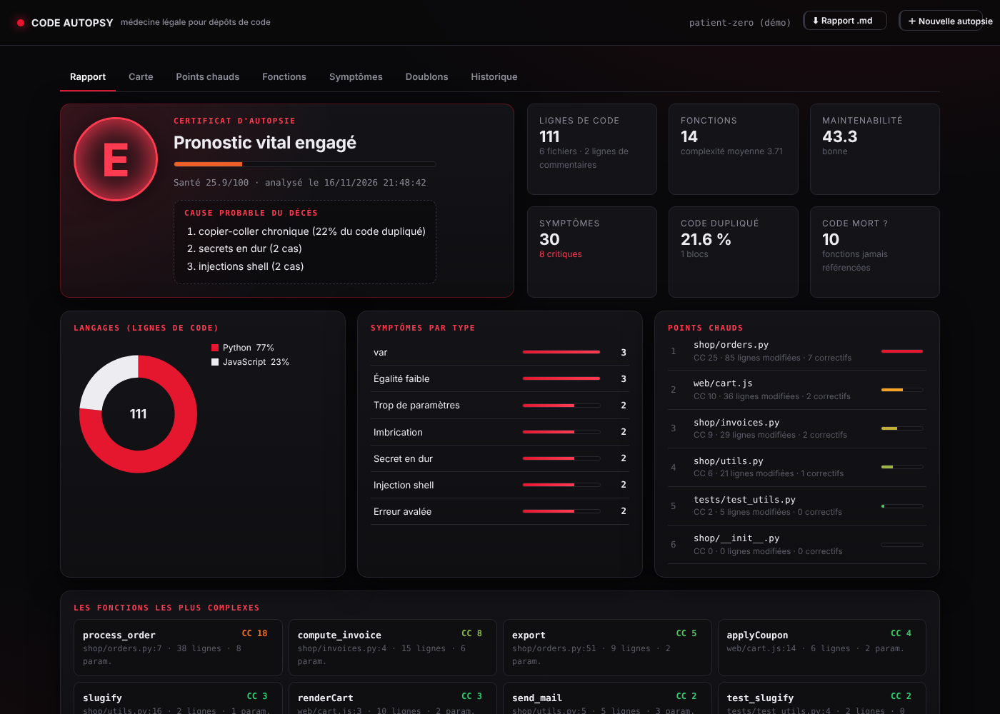
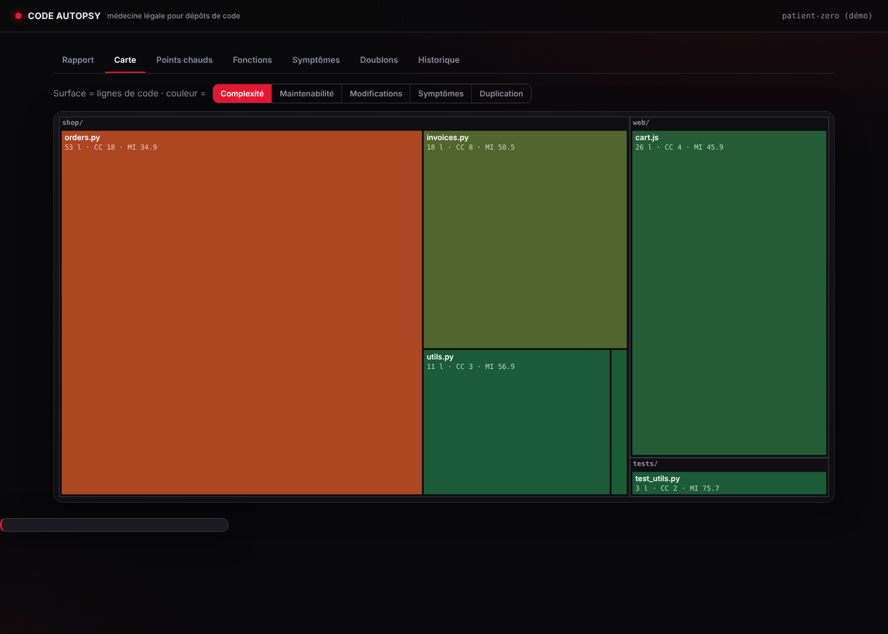
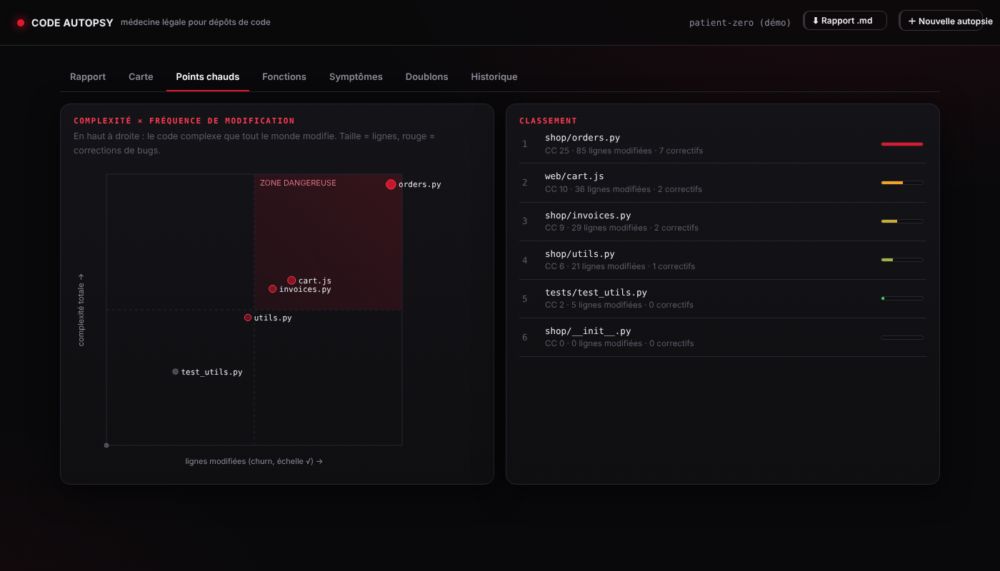
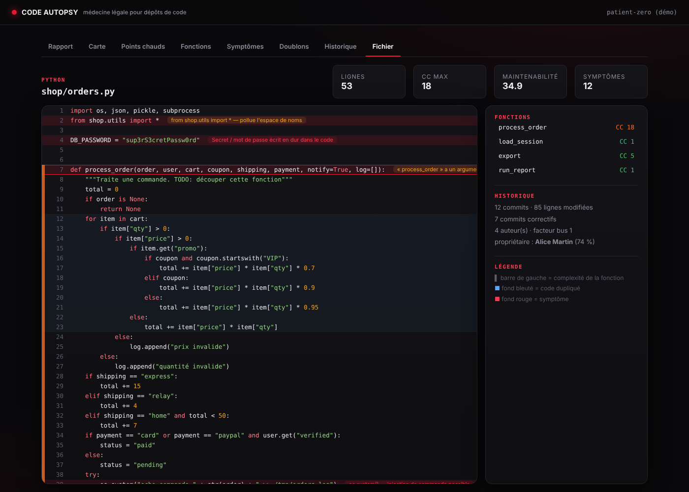

# 🩻 Code Autopsy

**Médecine légale pour dépôts de code.** Déposez un projet sur la table : Code Autopsy mesure sa complexité, traque les failles et le code dupliqué, lit l'historique Git pour trouver les *points chauds* — puis rédige un certificat d'autopsie avec la cause probable du décès.



## Ce qui est analysé

| Analyse | Détail |
|---|---|
| **Complexité** | Complexité cyclomatique par fonction (exacte en Python via `ast`, heuristique pour JS/TS, C/C++, Java, Go, Rust, PHP…), longueur, nombre de paramètres, profondeur d'imbrication |
| **Maintenabilité** | Indice de maintenabilité (Halstead + complexité + taille) par fichier |
| **Sécurité** | `eval`/`exec`, injections shell (`os.system`, `shell=True`), `pickle.loads`, `yaml.load`, TLS désactivé, secrets/clés écrits en dur, XSS (`innerHTML` non échappé), `strcpy`/`gets`/`sprintf` |
| **Qualité** | `except:` nu, erreurs avalées, arguments par défaut mutables, `import *`, imports inutilisés, `== None`, `var`, égalité faible, TODO/FIXME |
| **Doublons** | Détection de blocs copiés-collés (fenêtres glissantes de lignes normalisées, fusionnées en blocs) |
| **Code mort** | Fonctions jamais référencées dans le projet |
| **Historique Git** | Churn par fichier, commits correctifs (fix/bug/hotfix…), auteurs, *facteur bus*, couplage caché (fichiers toujours modifiés ensemble), activité par semaine |
| **Points chauds** | Complexité × fréquence de modification : là où les bugs naissent |

Une **note de A à E** synthétise le tout, avec les 3 causes principales.

## Interface

| Carte du projet (treemap) | Points chauds |
|---|---|
|  |  |
| **Fichier annoté** | **Historique Git** |
|  |  |

- **Carte** : treemap « squarified » maison, surface = lignes de code, couleur au choix (complexité, maintenabilité, modifications, symptômes, duplication).
- **Fichier** : code coloré, barre de complexité dans la marge, symptômes annotés en ligne, zones dupliquées surlignées.
- **Rapport Markdown** téléchargeable.

Trois façons d'analyser : glisser une **archive .zip** (export GitHub accepté, protégé contre le *zip slip*), un **dossier local** (avec `.git` pour l'historique) ou la **démo « patient zéro »** — un mini dépôt Git généré avec 18 commits et 4 développeurs, volontairement malade.

## Lancer

```bash
pip install -r requirements.txt
python3 app.py          # http://127.0.0.1:5026
```

`AUTOPSY_ALLOW_PATHS=0` désactive l'analyse de dossiers locaux si vous exposez le serveur.

L'analyseur est aussi utilisable seul :

```python
from autopsy.analyzer import analyze_project
r = analyze_project("/chemin/vers/projet")
print(r["summary"]["grade"], r["summary"]["causes"])
```

## Tests

```bash
python3 -m pytest -q
```

## Structure

```
autopsy/analyzer.py   moteur : AST Python, heuristiques multi-langages, doublons, Git, score
autopsy/demo.py       génération du dépôt de démonstration
app.py                API Flask
static/               interface (treemap.js, app.js, autopsy.css)
```

Licence MIT.
